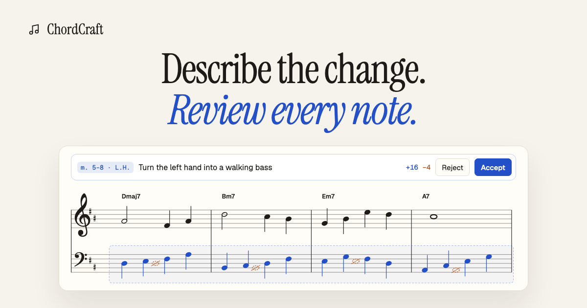

# ChordCraft

A piano score editor with a composing partner. Select a few bars, describe the change, and
review the AI's edit note by note before it lands.

**Try it: [usechordcraft.vercel.app](https://usechordcraft.vercel.app)**



- **Edit by describing it.** Press ⌘K on a selection, or ask in the chat panel. Only the bars
  you picked change.
- **Review the diff.** Drafted notes show in blue and the notes they replace in dashed orange,
  right on the staff. Listen, then accept (⌘↵) or reject the whole edit.
- **Checked before you see it.** A music checker sends back bars that don't add up and flags
  out-of-range notes, parallel fifths and odd spellings.
- **Tab to continue.** Pause at the end of a phrase and it suggests the next bar.
- **Every edit is a version.** Undo, redo, and restore any earlier revision.
- **Start anywhere.** A blank page, a chord progression, or an imported MusicXML or MIDI file.

Built with React, TypeScript, VexFlow and Tone.js on the front end; FastAPI, PostgreSQL, Redis
and a LangGraph agent on Claude behind it. See [docs/PLAN.md](docs/PLAN.md) for the
architecture, and [docs/DEPLOY.md](docs/DEPLOY.md) to run your own (Vercel, Railway, Supabase).

## Layout

```
web/   React + TypeScript + Vite (VexFlow notation, Tone.js playback)
api/   FastAPI, SQLAlchemy, Alembic, arq worker (LangGraph agent)
docs/  Plan and design notes
```

## Local development

Start Postgres and Redis:

```bash
docker compose up -d
```

API (from `api/`):

```bash
python3 -m venv .venv && .venv/bin/pip install -e ".[dev]"
cp .env.example .env
.venv/bin/alembic upgrade head
.venv/bin/uvicorn app.main:app --reload
```

Worker (from `api/`), needed for agent edits (⌘K) and the chat panel:

```bash
.venv/bin/arq app.worker.WorkerSettings
```

To restart it automatically when backend code changes (arq's own `--watch` keeps old modules
loaded):

```bash
.venv/bin/watchfiles --filter python ".venv/bin/arq app.worker.WorkerSettings" app
```

Web (from `web/`):

```bash
npm install
npm run dev
```

The web app proxies `/api/*` to `http://localhost:8000`. Open http://localhost:5173; without
Supabase settings in `web/.env.local` there's no sign-in. `http://localhost:8000/health` should
report `postgres: true` and `redis: true`.

## Edit agent (command line)

Runs the LangGraph edit agent against a score file and prints each step, the before/after
measures, the validation checks, and token usage. Needs `ANTHROPIC_API_KEY` in `api/.env`, or
`GEMINI_API_KEY` with `AGENT_MODEL` set to a `gemini-*` model (or pass `--model gemini-...`).

```bash
cd api && .venv/bin/python -m app.agent.cli "Turn the left hand into a walking bass line" --measures 5-8 --staff LH
```

## Checks

```bash
cd api && .venv/bin/ruff check . && .venv/bin/pytest -q
cd web && npm run lint && npm test && npm run build
```

## License

[MIT](LICENSE)
